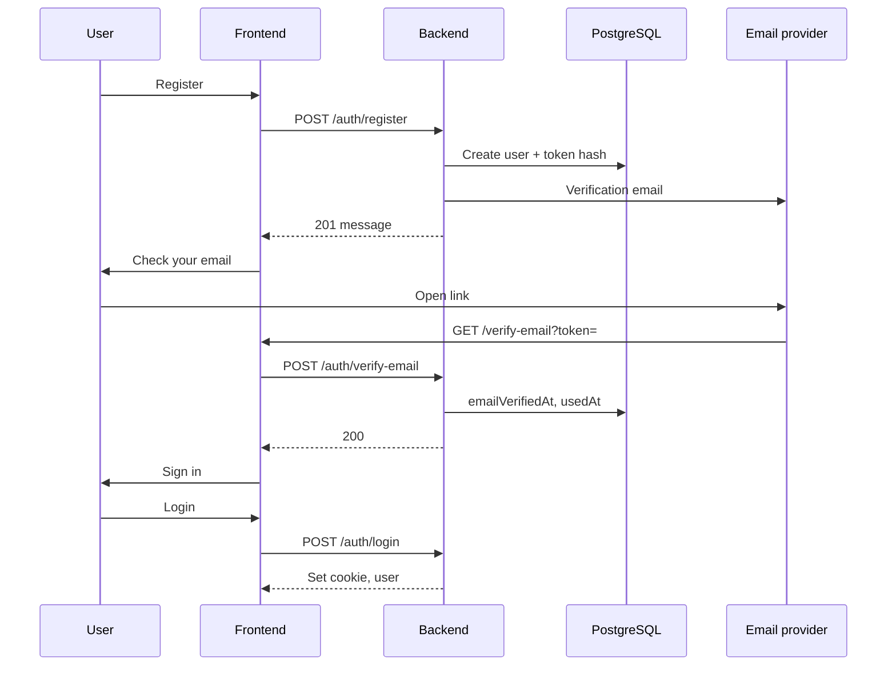

# Design Document: Email Verification at Registration

**Status:** Proposed; not implemented (the previous implementation attempt was reverted)
**Priority:** Medium — security and account integrity
**Target stack:** Express 5 API, PostgreSQL (Prisma), React SPA (Vite)
**Related:** [todo-be.md](./todo-be.md), [email-verification-implementation.md](./email-verification-implementation.md), [for-next-version-be.md](./for-next-version-be.md) (future `auth_epoch` / refresh tokens)

---

## 1. Executive Summary

When a user registers with an email and password, the application must confirm **inbox ownership** before the user can sign in and use protected features.

The chosen model is **verify before sign-in**: registration creates the account and sends a verification message; login is rejected until `emailVerifiedAt` is set. This matches common fintech and SaaS practice and fits the existing flow (register → redirect to login, no session on signup).

This document does **not** replace password auth with magic links and does **not** require an external identity provider.

**Implementation status:** This document describes target behavior, not current production behavior. Until the backlog is completed, registration does not require email verification and the verification endpoints should not be assumed to exist.

**Architecture boundary:** This design extends the current password-based authentication flow. If the OIDC/BFF proposal in [auth-sys-design.md](./auth-sys-design.md) is adopted, revisit this flow and its session assumptions before implementation.

---

## 2. Goals and Non-Goals

### 2.1 Goals

1. Prove the registrant controls the email address they entered.
2. Block sign-in and API access for unverified accounts.
3. Preserve **anti-enumeration** on register and resend (same spirit as today’s generic register response).
4. Store verification secrets safely (hashed, single-use, expiring).
5. Fit existing layer boundaries: routes → controllers → services → repositories.
6. Fit the frontend auth slice (`services/`, `pages/`, `components/routing/`).

### 2.2 Non-Goals

- Proving an address is “high quality” via third-party email validation APIs (ZeroBounce, etc.) — optional later if abuse appears.
- Blocking disposable email domains — optional supplement, not a substitute for verification.
- Passwordless / magic-link-only authentication.
- Moving verification to Auth0, Cognito, or Clerk unless the product later adopts OIDC.
- Marketing double opt-in (newsletters) — out of scope unless product asks for it.

### 2.3 Terminology

| Term | Meaning |
|------|---------|
| **Ownership verification** | User completes an action only possible with inbox access (link or OTP). |
| **Quality / abuse controls** | Blocklists, MX checks, etc. — separate concern. |

---

## 3. Approach Selection

### 3.1 Patterns considered

| Pattern | Description | Fit for MyFinance |
|---------|-------------|-------------------|
| **Verify before sign-in** | No session until email verified | **Recommended** |
| Verify after sign-in | Login OK; limited UI until verified | Weaker for finance; extra “half-auth” states |
| Magic-link registration | Email link is the login | Conflicts with current password model |
| IdP `email_verified` claim | External OIDC handles mail | Not current architecture |
| Validation APIs only | SMTP/risk scoring without user action | Does not prove ownership |

### 3.2 Decision

Implement **verify before sign-in** using **opaque single-use tokens** delivered by **transactional email** (link to SPA, backend validates token).

**Primary verification mechanism:** clickable link (`{FRONTEND_URL}/verify-email?token=...`).

**Optional later:** 6-digit OTP in email for mobile-first UX — same token table could store a hashed code instead of or in addition to link tokens; not required for v1.

---

## 4. Current System Context

Relevant behavior today:

- `POST /auth/register` creates a user; duplicate email returns generic **201** (no enumeration).
- `POST /auth/login` sets httpOnly `access_token` cookie; JSON returns `{ user }` only.
- Register UI navigates to login with a notice; no cookie on signup.
- `requireAuth` verifies JWT only; does not load full user from DB yet (planned hardening in `for-next-version-be`).
- CSRF: mutating requests require `Origin === FRONTEND_URL` unless Bearer.
- Rate limits: register (5/hour), login (10/15 min) per IP+email (in-memory today).

Email verification should **not** store access or refresh tokens in the verification link or in browser storage.

---

## 5. Data Model

### 5.1 User

Add to `User` (Prisma):

| Field | Type | Notes |
|-------|------|--------|
| `emailVerifiedAt` | `DateTime?` `@db.Timestamptz` | `null` until verified; set once on success |

Existing users (if any at migration time): backfill `emailVerifiedAt = createdAt` or force re-verification — **choose explicitly in migration** (recommend backfill for existing rows to avoid lockout).

### 5.2 Email verification tokens

New table `email_verification_tokens` (name may follow project snake_case mapping):

| Field | Type | Notes |
|-------|------|--------|
| `id` | UUID PK | |
| `userId` | UUID FK → users | On delete cascade |
| `tokenHash` | String unique | SHA-256 of raw token; never store raw token |
| `expiresAt` | Timestamptz | e.g. 48h from creation |
| `usedAt` | Timestamptz nullable | Set on successful verify |
| `createdAt` | Timestamptz | |

**Rules:**

- Raw token: ≥ 32 bytes from a CSPRNG, URL-safe encoding for the link.
- On **resend**: mark unused tokens for that user as revoked (or delete rows) and insert one new token.
- At most one “active” unused token per user is enough for v1.

Aligns with planned refresh-token storage pattern in `for-next-version-be` (hash only, opaque secret).

---

## 6. API Contract

All paths under existing auth module unless a dedicated small module is preferred. Validate bodies at the HTTP boundary.

### 6.1 Register — `POST /auth/register` (change behavior)

**Existing input:** `email`, `password`, `name`.

**Behavior:**

1. Same validation and anti-enumeration as today (duplicate email → generic success response, no user leak).
2. For a **newly created** user:
   - Insert verification token (hash).
   - Send transactional email with verify link.
3. **If email send fails — decision required before implementation:**
   - **Synchronous delivery:** choose and test a consistent failure policy. Do not assume a database transaction can atomically commit a user and a remote email send; compensate carefully if the send fails.
   - **Transactional outbox (preferred for resilient delivery):** commit the user, verification-token row, and outbox event in one database transaction; return after commit and let a worker retry delivery. This is the target described in §8.4 and removes the provider from the registration request's critical path.

**Response (201):** update message for new registrations, e.g.
`"Check your email to verify your account, then sign in."`
Duplicate-email path keeps the same generic message as today (no branch that reveals taken email).

### 6.2 Verify — `POST /auth/verify-email`

**Body:** `{ "token": string }`
**CSRF:** yes (Origin check).

**Behavior:**

1. Hash the raw token from the request body.
2. In one transaction, **atomically claim** the token with a conditional update (e.g. Prisma `updateMany`) where `tokenHash` matches, `usedAt` is null, and `expiresAt > now`, setting `usedAt = now()`. Only the request that updates exactly one row wins; concurrent attempts on the same token get zero rows and must not verify the user.
3. If the claim fails → **400** with generic message: `"Invalid or expired verification link."`
4. Using the `userId` from the claimed token row (not caller-supplied identity), set `users.emailVerifiedAt = now()` where `emailVerifiedAt` is still null. If the user was already verified (e.g. concurrent verify with another token), treat as success without rolling back the token claim.
5. If the user update fails for any other reason, roll back the transaction so the token is not left consumed without a verified user.

**Response (200):** e.g. `{ "message": "Email verified. You can sign in." }`

Do not set auth cookies on verify (user still signs in with password).

### 6.3 Resend — `POST /auth/resend-verification`

**Body:** `{ "email": string }`
**CSRF:** yes.

**Behavior:**

1. Normalize/validate email like register.
2. If user exists and `emailVerifiedAt` is null: invalidate old unused tokens, create new token, send email.
3. If user does not exist, or already verified: **no email**; same response as success.

**Response (200 or 202):** always generic, e.g.
`"If an account exists and is unverified, we sent a verification email."`

**Rate limit:** stricter than register — e.g. **3 requests / hour** per IP+email (add to rate-limit middleware).

### 6.4 Login — `POST /auth/login` (change behavior)

After successful password check:

- If `emailVerifiedAt` is null → **403 Forbidden** with stable machine-readable code, e.g.
  `{ "code": "EMAIL_NOT_VERIFIED", "message": "Verify your email before signing in." }`
- Do **not** set `access_token` cookie.

Use **403** (authenticated identity known but action forbidden), not **401**, so the SPA can distinguish bad password from unverified email without breaking “invalid credentials” messaging for wrong passwords.

Wrong password / unknown email: unchanged (**401**, indistinguishable messages).

### 6.5 Protected routes — defense in depth

**Phase 1:** Login gate only (unverified users never receive JWT).

**Phase 2 (with `for-next-version-be`):** When `requireAuth` loads user by `sub` and checks `auth_epoch`, also reject if `emailVerifiedAt` is null → **401**.

---

## 7. End-to-End Flows

### 7.1 Happy path

### 7.2 Unverified login

1. User submits login.
2. API validates password → 403 `EMAIL_NOT_VERIFIED`.
3. SPA shows message + “Resend verification email” (email prefilled from form).

### 7.3 Resend

1. User submits email on login or dedicated UI.
2. API always returns generic success body.
3. Email sent only when account exists and is unverified.

---

## 8. Email Delivery

### 8.1 Provider

Use a **transactional** provider (e.g. Resend, Postmark, Amazon SES, SendGrid):

- Env: API key, verified `FROM` address, optional template ID.
- Domain: configure SPF, DKIM, DMARC for the sending domain.

### 8.2 Message content

- Subject: clear and branded (e.g. “Verify your MyFinance email”).
- Body: short explanation + button linking to
  `{FRONTEND_URL}/verify-email?token={rawToken}`
- Mention link expiry (48 hours).
- No passwords, no JWTs, no session cookies in the email.

### 8.3 Sending strategy

- **MVP:** synchronous send in register/resend service with timeout; surface failure according to strict vs outbox policy (§6.1).
- **Later:** Postgres outbox + worker (no Redis required); retries with backoff — full checklist in **§8.4**.

### 8.4 Production hardening (defer until load or multi-instance)

The **verification token model** (two tables, hashed secrets, atomic claim) is appropriate at scale. What changes under heavy load is **how email is sent**, not how tokens are stored or verified.

**Keep as-is when scaling**

- `email_verification_tokens` + conditional `updateMany` claim + `users.emailVerifiedAt`.
- Verify-before-sign-in, anti-enumeration, CSRF on mutating auth routes.
- Transactional provider (Resend, SES, Postmark, etc.) with SPF/DKIM/DMARC on the sending domain.

**Upgrade delivery when any of these apply**

- More than one stateless API instance (horizontal scale).
- Register/resend latency or error rate tracks the email provider.
- Signup spikes tie up request workers on outbound `fetch`.
- SLO requires register to succeed even if the provider is briefly down (account exists; email catches up).

**Target architecture: transactional outbox**

1. In the **same database transaction** as `createUser` + `replaceEmailVerificationTokenForUser`, insert an **outbox row** (e.g. `email_outbox`: `id`, `type`, `payload` JSON, `status`, `attempts`, `nextAttemptAt`, `createdAt`, optional `idempotencyKey`).
2. **HTTP handler returns 201/200** after commit — does **not** await the provider.
3. A **worker process** (or cron + `FOR UPDATE SKIP LOCKED`) polls pending rows, calls `sendVerificationEmail` (or provider API), marks `sent` or schedules retry.
4. **Retries:** exponential backoff on 5xx/timeouts; cap attempts; move to **dead-letter** / `failed` status for ops replay (do not delete the user silently).
5. **Idempotency:** one outbox row per logical send (e.g. key `verify:{userId}:{tokenRowId}` or resend batch id) so worker retries do not double-send the same verification wave.

No Redis is required for the outbox itself; Postgres is enough. Redis still needed for **cross-instance rate limits** (see below).

**Sync MVP improvements (cheap, do before or with outbox)**

- **`fetch` timeout** (e.g. 5–10s `AbortSignal`) in `deliverEmail`; treat timeout like provider failure.
- **Strict register policy (§6.1):** if still synchronous, failed send → do not leave an orphan unverified user without ops visibility (rollback or outbox — prefer outbox once worker exists).
- **Provider templates** in Resend/SES for HTML (optional; ops convenience, not throughput).

**Rate limiting at scale**

- In-memory `express-rate-limit` is **per process only** — ineffective with multiple API instances.
- Move login, register, and **resend-verification** counters to a **shared store** (Redis via `rate-limit-redis` or equivalent), same keys as today (IP + email). See `for-next-version-be` (rate limit store).
- Resend: keep stricter window (e.g. 3/hour per IP+email).

**Resend idempotency (product + ops)**

- API response stays generic (§6.3).
- Optionally debounce: if an unused token was created in the last N minutes, resend may **reuse** the same raw token in a new email instead of rotating — reduces token churn and outbox volume (document choice in implementation).

**Observability (required before calling it “production scale”)**

- Metrics: outbox depth/lag, send success/failure, retry count, verify success/failure, login blocked `EMAIL_NOT_VERIFIED`.
- Alerts: outbox lag above threshold, sustained send failures, spike in resend rate.
- Logs: request id, user id; **never** raw token or full verify URL.

**What not to do**

- Do not send mail from app servers via raw SMTP at scale — use a transactional API.
- Do not block the verify endpoint on email send (verify only touches Postgres).
- Do not weaken atomic token claim for performance (indexes on `token_hash` and `user_id` are sufficient).

**Acceptance for “hardened” tier**

- Register/resend HTTP p99 independent of provider p99 (outbox + async worker).
- All API instances share the same rate-limit counts.
- Failed sends are visible (metrics + failed outbox rows) and retryable without user re-registering.

---

## 9. Frontend (SPA)

Locations follow `frontend.mdc` auth slice.

| Piece | Location / route |
|-------|------------------|
| Verify page | `src/pages/VerifyEmailPage.tsx`, route `/verify-email` |
| Register copy | Update notice after register (already passes `state.notice` to login) |
| Login | Handle `403` + `EMAIL_NOT_VERIFIED`; resend action |
| API | `src/services/auth.ts`: `verifyEmail`, `resendVerification` |
| Types | Parse codes in `api-parse.ts`; extend error handling in `api.ts` if needed |
| Routes | `src/routes.ts` + `router.tsx` (public route, guest-accessible) |

**Verify page behavior:**

1. Read `token` from query string.
2. If missing → show error + link to login/register.
3. If present → `POST /auth/verify-email` with credentials include + CSRF via same-origin fetch.
4. Success → navigate to login with success notice.

**Storage:** Do not put verification tokens in `localStorage` / `sessionStorage`. Token may appear briefly in URL; consider `replace` navigation to strip query after POST.

Optional v2: `/verify-email-pending` with static copy — not required if register/login notices suffice.

---

## 10. Security Requirements

1. **Hash tokens at rest** (SHA-256); log only token id or user id, never raw token or full URL.
2. **Single use** — second submit with same token fails with generic error.
3. **TTL** — default 48 hours; configurable via env.
4. **Rate limits** — resend (§6.3); optional cap on verify POST per IP to slow online guessing (token entropy makes brute force infeasible; limit still good hygiene).
5. **Anti-enumeration** — register and resend responses must not reveal account existence or verified state.
6. **CSRF** — verify and resend are mutating; enforce existing Origin policy.
7. **HTTPS** — production already enforced; links must use `FRONTEND_URL` HTTPS origin.

---

## 11. Observability and Audit

When structured logging / login audit lands (`for-next-version-be`):

- Log verification **success** and **failure** (invalid/expired) with request id, user id if known, IP — no token, no email in clear if policy treats email as PII (hash/redact).
- Metric counters: emails sent, verify success, verify failure, resend requests, login blocked unverified.

---

## 12. Testing Requirements

### Backend

1. New user register creates token hash and triggers send (mock mailer).
2. Verify with valid token sets `emailVerifiedAt` and `usedAt`.
3. Reused token → 400 generic.
4. Expired token → 400 generic.
5. Login before verify → 403 `EMAIL_NOT_VERIFIED`, no cookie.
6. Login after verify → 200 + cookie (unchanged aside from gate).
7. Resend for verified user → 200, no new email.
8. Resend for unknown email → 200, no email.
9. Register duplicate email → generic response, no extra email to attacker pattern (behavior unchanged).

### Frontend

1. `parseAuthRegisterResponse` / API error parsing for new codes.
2. Verify page calls API and navigates on success.
3. Login shows resend path on `EMAIL_NOT_VERIFIED`.

---

## 13. Implementation Phases

| Phase | Scope |
|-------|--------|
| **1** | Prisma migration, token repository, mailer abstraction, register + verify + resend + login gate |
| **2** | SPA routes/pages/services, copy updates |
| **3** | Rate limit resend, tests, env docs (`.env.example`) |
| **4** | With refresh/`auth_epoch`: unverified check in `requireAuth` |
| **Later (scale)** | **§8.4** — Postgres email outbox + worker, shared rate-limit store, fetch timeouts, observability |
| **Later (product)** | Disposable domain list, OTP option, email change re-verification |

---

## 14. Future Interactions

| Feature | Interaction |
|---------|-------------|
| **Password reset** | Require verified email before reset, or verify as part of reset — decide when reset ships. |
| **Email change** | Set new email unverified; keep old email active until new link confirmed. |
| **`auth_epoch` bump** | Do **not** bump on verify (no session yet). Bump on password change / logout-all as planned. |
| **Existing JWT until expiry** | Unverified users must not receive JWT; no special case. |

---

## 15. Environment Variables (proposed)

Add to backend env validation and example env file (no secrets committed):

| Variable | Purpose |
|----------|---------|
| `EMAIL_FROM` | Sender address |
| `EMAIL_PROVIDER_*` | Provider-specific (API key, region, etc.) |
| `EMAIL_VERIFICATION_TTL_HOURS` | Default 48 |
| `FRONTEND_URL` | Already used; base for links in emails |

---

## 16. Acceptance Criteria

Implementation is acceptable when:

- New registrations receive a verification email with a working link.
- Unverified users cannot obtain a session cookie via login.
- Verified users can log in as today.
- Tokens are hashed, expiring, and single-use.
- Register and resend do not enumerate accounts.
- Frontend completes verify flow without storing tokens in web storage.
- Automated tests cover §12 core cases.

---

## 17. References

- Backend module layout: `backend/AGENTS.md`, `.cursor/rules/application-structure.mdc`
- Frontend auth slice: `.cursor/rules/frontend.mdc`
- Planned session hardening: [for-next-version-be.md](./for-next-version-be.md)
